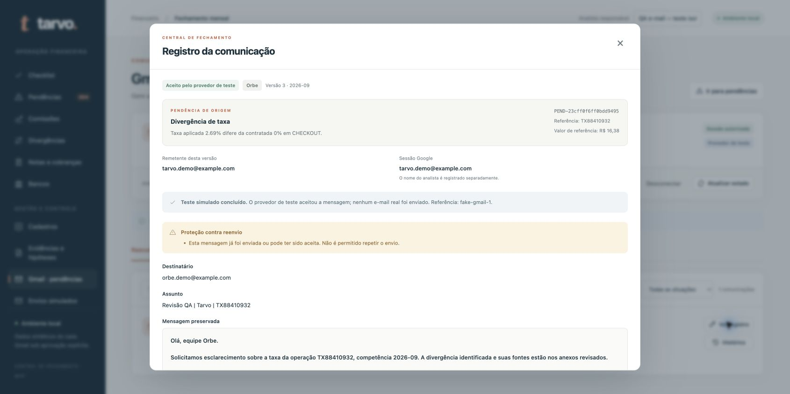

# Sugestões de contestação com permissão — 17/10/2026

> Registros históricos de verificações em branches e momentos distintos. Contagens, portas e estados de Gmail/runs valem para cada verificação descrita e não demonstram o estado atual. Nenhum resultado simulado comprova entrega real; veja o [guia atual de Gmail](GMAIL.md).

Na branch `codex/email-real-demo`, a execução prepara sugestões por parceiro, competência e motivo. Nenhuma contestação é enviada pelo callback da run. O responsável salva a versão, revisa texto, remetente, destinatário e anexos, marca sua permissão e confirma o envio. Mudanças invalidam a autorização. As mensagens têm resumo curto e detalhamento nos anexos.

- **256 testes do backend passaram** na suíte completa, em 674,155 segundos, incluindo as regressões de importação, processamento e gravação.
- **13 testes do serviço passaram**, incluindo evidências imutáveis, conteúdo e anexos adulterados, revisão obrigatória, concorrência, reinício e resultado incerto.
- **7 testes de API passaram**, com pipeline e banco reais e SMTP injetado. O histórico permanece acessível após rejeitar a execução. A suíte de API foi repetida após a proteção por ocorrência e passou novamente em 156,063 segundos.
- **108 testes de frontend passaram**; TypeScript e compilação final de produção passaram. A interface antiga também passou na verificação de sintaxe e exige permissão explícita.
- A deduplicação foi verificada com um grupo enviado, uma nova execução com mais uma ocorrência, outra com uma ocorrência a menos e outra com evidência financeira alterada. Somente a ocorrência nova ou alterada entra em uma nova mensagem; todas as repetições ficam bloqueadas.
- Na revisão visual com provedor simulado, salvar não enviou, a confirmação começou desmarcada, editar o assunto invalidou a permissão anterior e a versão 3 exigiu uma nova autorização. Houve somente uma aceitação no provedor fictício (`fake-gmail-1`), com indicação visível de simulação e sem erros no console.
- Na demo real da porta 8770, uma execução de teste produziu cinco sugestões (243 ocorrências) e 108 exclusões justificadas. As cinco permanecem aguardando revisão. O Gmail está desconectado e os avisos internos estão desativados.

Os avisos internos continuam com autorização própria, separada da permissão individual de contestações. O controle de repetição por ocorrência pertence ao novo fluxo de sugestões; o editor individual antigo mantém seu histórico independente.

**Limite:** nenhuma autenticação ou entrega real foi confirmada. Os testes usam provedores injetados, sem conexão ao Gmail para enviar mensagens. A autorização Google ainda depende do login do titular.

Registros e capturas: `evidence/email-suggestions/`, incluindo `backend-tests-final.txt`, `api-tests.txt`, `frontend-verification.txt`, `frontend-final-build.txt`, `browser-verification.json` e `review-permission.png`. O patch de revisão nessa pasta compara o código com a cópia inicial, incluindo as alterações locais que já existiam; a cópia original recebeu mudanças paralelas posteriores e não foi sobrescrita nem integrada por esta tarefa. Nenhum commit ou push foi feito.

---

# Revisão da demo de e-mail — 17/10/2026

Branch: `codex/email-real-demo`, em worktree isolada. A cópia original permaneceu na branch `main`, com o mesmo diff local de início. Nenhum commit, push ou alteração no banco original foi realizado.

- Suíte completa do backend: **235 testes passaram**, em 246,009 segundos.
- Após corrigir a descoberta de certificados TLS do Python no Mac, os **66 testes de e-mail passaram novamente**, em 34,040 segundos.
- Frontend: **89 testes passaram**; compilação de produção concluída.
- Revisão visual da tela real desconectada na porta 8770: conta e destinatários preenchidos, troca Orbe/Ponte, ações bloqueadas até conectar e nenhum erro no console.
- Conexão externa ao `smtp.gmail.com:465`: TLS verificado com certificados `certifi`, resposta EHLO 250. A configuração padrão de certificados deste Python estava ausente; o transporte agora usa a cadeia incluída nas dependências, mantendo verificação do certificado e hostname.

Os testes exercitam a conexão SMTP por senha de app, a sessão e CSRF, o envio manual com conteúdo exato, deduplicação, falhas conhecidas, resultados incertos, desconexão e avisos reais do pipeline por integração HTTP com transporte isolado. As notificações não mudam o resultado financeiro, usam destinatário explícito e não repetem tentativas automaticamente. O fluxo OAuth anterior continua coberto.

**Limite de verificação:** nenhuma autenticação real na conta e nenhum envio externo foram efetuados. A conta ainda precisa ser conectada pela interface; somente a verificação da caixa confirma recebimento. O teste de conexão TLS não comprova login ou entrega. Os avisos começam desativados e são habilitados em “Salvar avisos”.

A demo desta branch usa banco próprio (`data/email-demo.sqlite3`) e pasta própria de runs (`saida/email-demo-runs`). Para abrir: http://127.0.0.1:8770/comunicacoes?aba=gmail. Os logs desta revisão estão em `evidence/email-real-demo/`, na raiz da worktree, e a captura visual em `evidence/email-demo-disconnected.jpg`. Guia atual: [GMAIL.md](GMAIL.md).

---

## Registro da implementação anterior

O registro abaixo é histórico; a configuração OAuth e as limitações da versão anterior não descrevem o novo fluxo simplificado.

# Verificação da integração Gmail

Em 17/10/2026, `./run.sh test` executou **130 testes com sucesso em 51,814 segundos**: 90 regressões existentes e 40 testes novos (17 de OAuth/provedor, 16 do serviço de mensagens e 7 da API). O registro completo está em [resultado-testes-email.txt](resultado-testes-email.txt).

Todos os testes de e-mail usam provedor simulado e bancos temporários. Nenhuma mensagem real foi enviada, nenhum consentimento Google real foi concluído e nenhuma credencial foi criada.

## Cobertura automatizada

| Área | Verificação |
|---|---|
| Contraparte e contatos | Checkout → Orbe; remessas → Ponte; ausência, duplicidade e origens misturadas bloqueiam; origem indefinida exige revisão justificada. Contatos de outros fluxos preservados. |
| Conteúdo e evidências | Modelos determinísticos; linhas relacionadas, operações originais e referências contratuais; HTML/CSV sem pacote integral. Edição de texto, múltiplas evidências, CSV seguro e anexos exatos no MIME enviado. |
| Desatualização | Mudança relevante na fonte, regra ou conta bloqueia; alteração sem relação com a pendência não invalida o rascunho. Atualização depende de ação explícita. |
| Sessão | Nome declarado não autoriza envio. Validação de conta Google, CSRF, origem, estado OAuth, vínculo com navegador, expiração, escopos mínimos, desconexão e renovação de token. Segredos não aparecem nas respostas. |
| Integridade | Aprovação exige versão e hash; remetente e todos os campos ficam preservados. Adulteração de anexos ou conteúdo bloqueia antes do provedor. |
| Concorrência | Duas chamadas da mesma versão produzem uma tentativa. Mutações financeiras aguardam o despacho. Revalidação após auditoria bloqueia alteração antes do envio. |
| Falhas | Rejeição conhecida permite nova versão e revisão; timeout, resposta inconclusiva e interrupção ficam incertos, sem repetição automática. Reinício conserva esse bloqueio. |
| Regressão | Avisos e cobranças continuam simulados. Rotas desses fluxos verificadas por HTTP. Envio não resolve pendência, não altera cálculos nem aprova fechamento. |

Verificações complementares: análise independente da autorização e concorrência; duas aprovações de rascunhos distintos concluíram em paralelo sem deadlock em banco temporário. A sintaxe de `web/app.js`, `web/workflow.js` e `web/mail.js` passou na verificação do Node.

## Roteiro executado no navegador

Servidor de teste isolado na porta 8766, iniciado explicitamente por `.venv/bin/python tests/serve_mail_demo.py`. Esse servidor injeta um provedor fictício; não há chave de configuração que transforme o servidor normal em provedor de teste.

1. Conectar a conta fictícia, com aviso visível de que não há envio ao Gmail real.
2. Cadastrar contato Orbe fictício no banco temporário.
3. Abrir a pendência da operação `TX88410932` e clicar **Gerar e-mail**.
4. Conferir contraparte, remetente, assunto, texto e dois anexos; abrir e inspecionar visualmente o relatório e baixar o CSV de 388 bytes.
5. Editar assunto/corpo, salvar, recarregar a página e reabrir; conteúdo e versão preservados.
6. Clicar uma vez **Aprovar e enviar**; confirmar o retorno `fake-gmail-1`, conteúdo preservado, histórico e bloqueio de reenvio.
7. Confirmar que a pendência permanece aberta e a quantidade de pendências permanece 304.
8. Desconectar; confirmar remoção da autorização e preservação do registro.
9. No servidor principal, conferir o estado sem credenciais, o bloqueio de conexão e o guia de configuração.

## Preservação do banco principal

A comparação antes/depois, após reiniciar o servidor atualizado, coincidiu em todos os 12 itens: tabelas `imports`, `merchants`, `rates`, `contacts`, `decisions`, `emails`, `runs` e valores originais de `result`, `source_data`, `closing`, `parameters`, `period`. Foram comparados os hashes SHA-256 das mesmas linhas ordenadas e dos valores JSON armazenados, sem recalcular ou sobrescrever dados. Evidência: [preservacao-email.json](preservacao-email.json).

Permaneceram R$ 207.039,73 de checkout, R$ 39.543,45 de remessas, 21 notas somando R$ 246.588,68, 237 divergências e 304 pendências. Nenhum contato ou rascunho de teste foi incluído no banco principal.

O lote do pipeline `run-b9db179689a645d6b8cafb39b5eafbd3` permanece `awaiting_approval`, com 305 exceções, sem decisão humana ou aprovação. O código da nova versão difere do snapshot antigo, portanto o bloqueio já existente `CODE_CHANGED` exige nova execução para futura aprovação. O responsável deve arquivar/reprovar o lote anterior para liberar a competência; isso não foi feito automaticamente. Os detalhes estão no [guia Gmail](GMAIL.md#execuções-do-pipeline-anteriores-à-atualização).

## Configuração ainda necessária e limites

O servidor principal informa exatamente `TARVO_GOOGLE_CLIENT_FILE` e `TARVO_GMAIL_TEST_ACCOUNT` ausentes. São necessários o arquivo OAuth Web fora do projeto, a conta de teste autorizada no Google Cloud e o URI de retorno cadastrado. Depois, conectar pela interface, cadastrar destinatários controlados e realizar a demonstração entre contas de teste conforme [GMAIL.md](GMAIL.md).

A troca real de tokens, o consentimento Google, a aceitação pela Gmail API e o recebimento no destinatário **não foram validados**. Os testes HTTP usam respostas simuladas, e o navegador usa autorização fictícia explícita. A aceitação pelo Gmail, quando ocorrer, não confirma entrega ou leitura. O servidor permanece local, com um processo; autenticação corporativa, múltiplos processos, leitura de respostas e emissão fiscal continuam fora do escopo.
